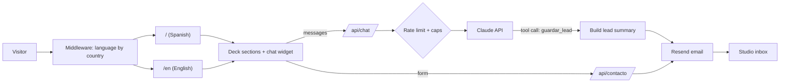

# Opra Agency Site

Bilingual marketing site for an AI automation studio, with an **AI diagnostic chat** that interviews a visitor about their business, suggests concrete automations and sends the qualified lead by email.

   

## Highlights

- **Diagnostic chat widget (Claude API):** a floating, bilingual assistant asks about the visitor's business and pain points, then proposes automations with an estimated impact. When the visitor leaves a contact, the model calls a strict-schema tool (`guardar_lead`) and the lead is emailed to the team with Resend.
- **Prompt caching and abuse limits:** the system prompt is cached, conversations are capped (turns, message length, output tokens) and an in-memory per-IP rate limit protects the quota.
- **Language by geography:** middleware reads the Vercel country header (falling back to `Accept-Language`) and sends non-Spanish-speaking first-time visitors to `/en`. A language toggle and a cookie remember the choice.
- **Contact form** with server-side validation, HTML-escaped email templates and a WhatsApp shortcut.
- **Horizontal "deck" layout** with snap sections, custom cursor, magnetic buttons, grain overlay and glow borders, with light and dark themes.

## Architecture



## Tech stack

- **Next.js 15** (App Router, route handlers, middleware) and **React 19**
- **TypeScript**, **Tailwind CSS 4**, **shadcn/ui** (Radix primitives)
- **Anthropic SDK** with tool use and prompt caching
- **Resend** for transactional email
- Deployed on **Vercel**

## Getting started

```bash
npm install
cp .env.example .env.local   # all variables are optional for the UI; the chat needs ANTHROPIC_API_KEY
npm run dev                  # http://localhost:3000
npm run build
```

| Variable | Purpose |
|---|---|
| `ANTHROPIC_API_KEY` | Enables the diagnostic chat (without it `/api/chat` returns 503) |
| `CHAT_MODEL` | Optional model override |
| `RESEND_API_KEY`, `CONTACTO_TO`, `CONTACTO_FROM` | Email delivery for leads and the contact form |
| `NEXT_PUBLIC_WHATSAPP` | WhatsApp number for the contact shortcut (digits, with country code) |

## Author

Built by [Ernesto Uribe](https://github.com/Ernesto-9).
